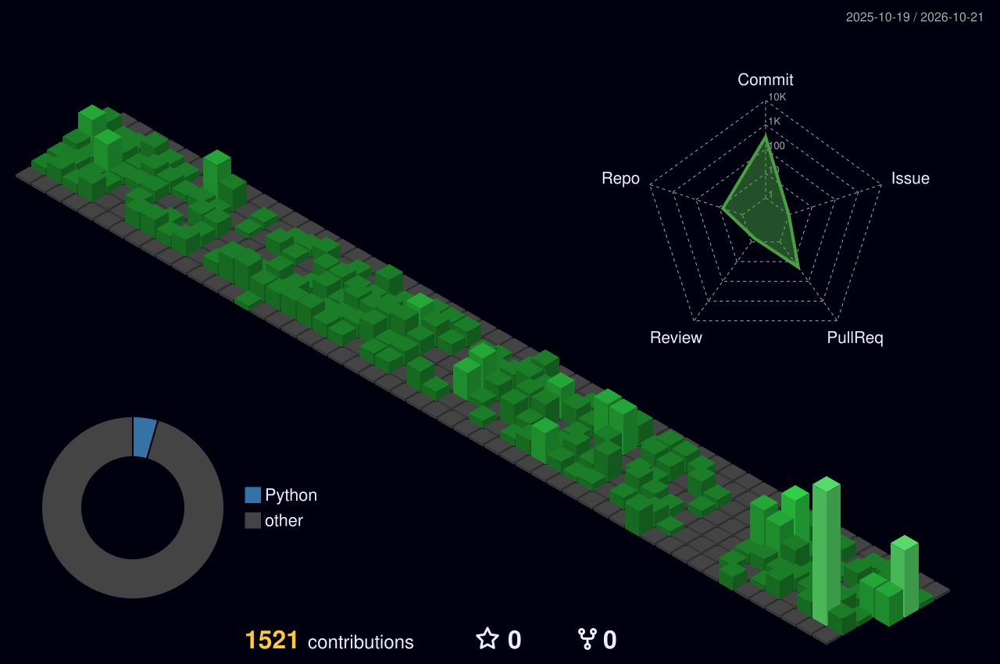
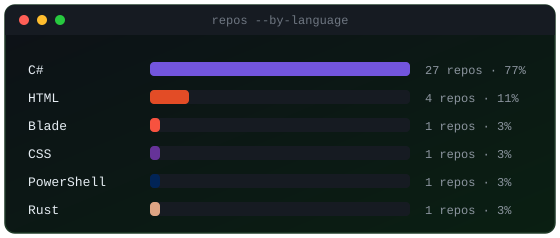
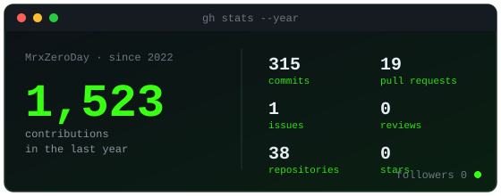

 

 

## ⌁ about

 

 

Languages are counted per repository (including private ones), not as a measure of skill. Most of my work is private, so the contribution graph above shows only part of it.

 

## ⌁ stack

<code>main</code>
 

  
<code>also</code>
 

  
<code>tools</code>
 

<code>$ ls --all   # libraries, payments, hosting</code>

 

**Laravel**&nbsp;

**.NET**&nbsp;

**Data**&nbsp;

**Payments**&nbsp;

**Hosting**&nbsp;

**Patterns**&nbsp;

 

## ⌁ what i build

Client work is private, so there are no public repos to link here.

 

## ⌁ focus

 

  

<code>> end of transmission_</code>

