

<a href="./README.md">EN</a> · RU

<picture><source media="(prefers-color-scheme: light)" srcset="./assets/core/header.ru.light.svg"></picture>

 

 

## ⌁ обо мне

<picture><source media="(prefers-color-scheme: light)" srcset="./assets/core/profile.ru.light.svg"></picture>

 

<picture><source media="(prefers-color-scheme: light)" srcset="./assets/data/contrib-3d.ru.light.svg"></picture>

 

<picture><source media="(prefers-color-scheme: light)" srcset="./assets/data/langs.light.svg">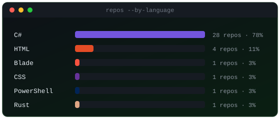</picture>

<picture><source media="(prefers-color-scheme: light)" srcset="./assets/art/note-langs.ru.light.svg"></picture>

<picture><source media="(prefers-color-scheme: light)" srcset="./assets/art/note-private.ru.light.svg"></picture>

 

## ⌁ стек

<picture><source media="(prefers-color-scheme: light)" srcset="./assets/art/label-main.ru.light.svg"></picture>
 
<picture><source media="(prefers-color-scheme: light)" srcset="https://skillicons.dev/icons?i=php,laravel,cs,dotnet&theme=light&perline=4"></picture>
  
<picture><source media="(prefers-color-scheme: light)" srcset="./assets/art/label-also.ru.light.svg"></picture>
 
<picture><source media="(prefers-color-scheme: light)" srcset="https://skillicons.dev/icons?i=js,ts,nodejs,vue,nuxtjs,py,html,css,alpinejs,tailwind,bootstrap,vite&theme=light&perline=12"></picture>
  
<picture><source media="(prefers-color-scheme: light)" srcset="./assets/art/label-tools.ru.light.svg"></picture>
 
<picture><source media="(prefers-color-scheme: light)" srcset="https://skillicons.dev/icons?i=mysql,postgres,redis,elasticsearch,docker,git,github,githubactions,nginx,linux,sentry&theme=light&perline=11"></picture>
 
<picture><source media="(prefers-color-scheme: light)" srcset="./assets/art/tools-clients.ru.light.svg"></picture>
  
<picture><source media="(prefers-color-scheme: light)" srcset="./assets/art/label-cloud.ru.light.svg"></picture>
 
<picture><source media="(prefers-color-scheme: light)" srcset="./assets/art/tools-cloud.ru.light.svg"></picture>
  
<picture><source media="(prefers-color-scheme: light)" srcset="./assets/art/label-favorites.ru.light.svg"></picture>
 
<picture><source media="(prefers-color-scheme: light)" srcset="https://skillicons.dev/icons?i=visualstudio,vscode,rider,phpstorm,postman&theme=light&perline=5"></picture>

<picture><source media="(prefers-color-scheme: light)" srcset="./assets/art/stack-more.ru.light.svg"></picture>

 

## ⌁ что я строю

<picture><source media="(prefers-color-scheme: light)" srcset="./assets/core/build.ru.light.svg">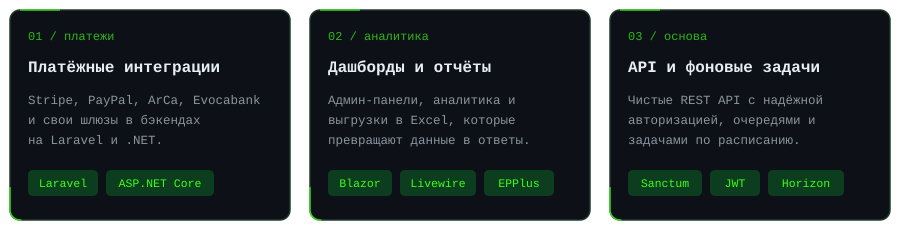</picture>

<picture><source media="(prefers-color-scheme: light)" srcset="./assets/art/note-client.ru.light.svg"></picture>

 

## ⌁ карты

<picture><source media="(prefers-color-scheme: light)" srcset="./assets/core/maps.ru.light.svg"></picture>

 

## ⌁ фокус

<picture><source media="(prefers-color-scheme: light)" srcset="./assets/core/focus.ru.light.svg"></picture>

 

<picture><source media="(prefers-color-scheme: light)" srcset="./assets/data/stats.light.svg">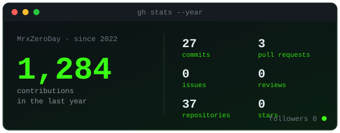</picture>

  

<picture><source media="(prefers-color-scheme: light)" srcset="./assets/art/footer.ru.light.svg"></picture>

